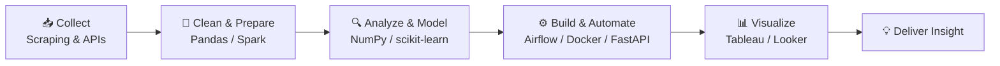

---

## 👋 About Me

Hi! I'm an aspiring Data Analyst and Data Engineer with 5 years of experience in Trust & Safety operations and Quality Assurance.

I don't just analyze data and present insights; I also build the tools, pipelines, and solutions that make data useful in the real world.

Through hands-on projects and data analytics training, I've developed skills in SQL, Python, data visualization, ETL, and data pipeline development.

🚀 How I Work with Data

📊 Turn raw data into meaningful insights and actionable dashboards.

⚙️ Build and automate data workflows and pipelines.

🧹 Clean, transform, and structure data for reliable analysis.

🔍 Identify patterns and trends to support data-driven decision-making.

🤝 Open to collaboration and conversations about data analytics and engineering.

🎯 Currently

Continuously learning and building projects to strengthen my skills in data analytics and engineering, with a focus on solving real-world data challenges.

---

## 🧭 What I Do

<table>
<tr>
<td width="50%" valign="top">

### 📈 Data Analysis
- Exploring and cleaning datasets
- Finding patterns, trends, and insights
- Designing dashboards and reports
- Communicating findings to stakeholders

</td>
<td width="50%" valign="top">

### 🛠️ Engineering
- Building and orchestrating data pipelines
- Developing APIs and automation tools
- Scraping and collecting data at scale
- Turning analysis into working systems

</td>
</tr>
</table>

---

## 🧰 Tech Stack

### 📊 Analytics & Visualization

### 🐍 Data Processing

### 🔧 Data Engineering

### 🗄️ Databases

### 🕸️ Web Scraping & Automation

### 📗 Spreadsheet Skills
| Area | Details |
|------|---------|
| **Formulas** | VLOOKUP, XLOOKUP, INDEX-MATCH, SUMIFS, COUNTIFS, nested IF |
| **Analysis** | Pivot Tables, Pivot Charts, Slicers, Conditional Formatting |
| **Data Cleaning** | Remove duplicates, Text to Columns, basic Power Query, data validation |
| **Reporting** | Report templates, dashboards in Excel and Google Sheets |

---

## 🔄 How I Work

---

## 📌 Portfolio

> ### 👉 My portfolio links are in the **Pinned** section below!
> Check out the repositories pinned at the bottom of this profile to see my analysis, dashboard, and engineering projects.

---

## 📫 Let's Connect

*Interested in collaborating or talking about data and engineering? Feel free to reach out!*

